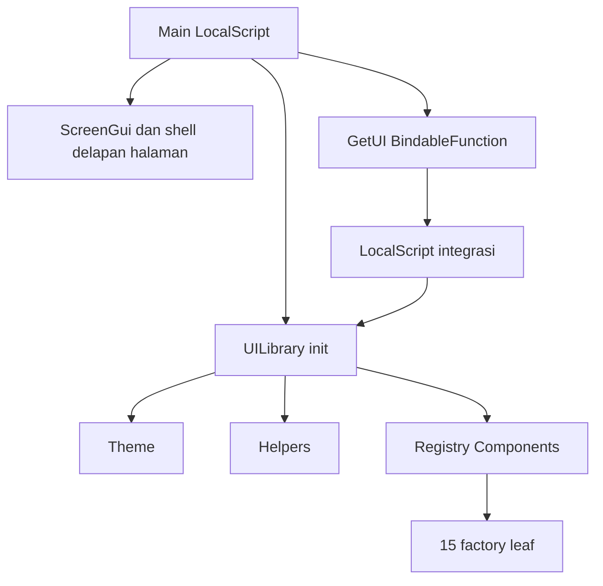

# Arsitektur

## Pembagian tanggung jawab

| Bagian | Tanggung jawab |
| --- | --- |
| `src/client/Main.client.lua` | Membuat ScreenGui AstralLite, topbar/sidebar/halaman, navigasi, drag/minimize/restore/close, respons viewport, endpoint GetUI. |
| `src/shared/UILibrary/init.lua` | Constructor khusus klien, validasi config umum/parent, holder notifikasi, registry komponen hidup, wrapper titik/kolon dan guard destroyed. |
| `Theme.lua` | Menyalin default per library dan memvalidasi override parsial terkelompok. |
| `Helpers.lua` | Validasi nilai/opsi/callback, pembuatan Instance, tween, scope cleanup, drag mouse/touch. |
| `Components/init.lua` | Registry beku 15 factory; tidak membuat UI saat require. |
| `Components/*.lua` | Factory leaf `(context, parent, config)` dengan context Theme/Helpers; tidak require entry library sehingga tidak membentuk siklus. |
| `ui.lua` | Arsip monolit asli; bukan sumber runtime baru dan tidak dipetakan. |

`require(UILibrary)` sendiri tidak membuat shell atau demo. `Library.new({ScreenGui=gui})` membuat holder notifikasi; komponen lain dibuat hanya saat factory dipanggil. Context mengurangi global/shared state, sehingga beberapa library dapat memiliki tema dan registry terpisah.

## Mapping yang direncanakan

- `ReplicatedStorage.UILibrary` menunjuk `src/shared/UILibrary`; `init.lua` menjadi ModuleScript utama, dengan Theme, Helpers, dan Components sebagai anak.
- `StarterPlayer.StarterPlayerScripts` menunjuk `src/client`; `Main.client.lua` menjadi LocalScript `Main`, disalin ke `Players.LocalPlayer.PlayerScripts.Main` saat Play.
- Root `ui.lua`, dokumentasi, tes, dan validator tidak masuk runtime.

Konfigurasi proyek Rojo **belum tersedia saat inspeksi**. Mapping ini adalah target integrasi, bukan klaim bahwa sinkronisasi/build sudah berjalan. `aftman.toml` tidak diubah.

## Inisialisasi shell dan integrasi

1. Main menunggu PlayerGui dan ModuleScript UILibrary.
2. Main membuat ScreenGui, menginisialisasi library, dan membuat scope shell terikat GUI.
3. Dibuat delapan ScrollingFrame: Home, Combat, Teleport, Player, Visuals, World, Misc, Settings. Isi awal hanya PageTitle dan layout; Home dipilih.
4. Koneksi input dan viewport dipasang, lalu GUI diparent ke PlayerGui dan layout diperbarui.
5. Main memasang OnInvoke sebelum memparent BindableFunction `GetUI` ke script. Consumer yang menunggu endpoint tidak menerima shell setengah terinisialisasi.
6. `GetUI:Invoke()` mengembalikan `UI, pages` langsung pada klien. Tidak ada RemoteEvent/RemoteFunction atau komunikasi server.

Map pages dan UI adalah objek yang sama untuk semua consumer, bukan salinan/sesi baru. Jangan membuat library kedua di ScreenGui Main hanya untuk memperoleh API yang sudah tersedia. Tidak ada API publik penambahan tab/pemilihan halaman; delapan kategori merupakan shell statis.

## Transaksi pembuatan komponen

Wrapper memvalidasi parent GuiObject, config tabel, Callback function/nil, Name string, serta LayoutOrder finite integer (default 1). Factory membangun di Frame staging tanpa parent melalui pcall. Jika konstruksi gagal, staging dihancurkan sehingga turunan dan scope terkait dibersihkan. Jika sukses, root dipindah ke parent tujuan, staging dihapus, lalu API didaftarkan.

Wrapper menormalkan titik/kolon dan memantau root.Destroying. Destroy menghapusnya dari registry; semua metode lain setelah itu error. API leaf tidak ditujukan untuk di-require langsung oleh aplikasi karena melewati validasi, registrasi, dan guard tersebut.

## Kepemilikan dan cleanup

| Pemilik | Yang dimiliki/dibersihkan | Yang tidak otomatis dimiliki |
| --- | --- | --- |
| Pemanggil Library.new | ScreenGui dan parent yang disuplai | Tidak diambil alih library |
| UI/library | Komponen hasil factory dan holder Notifications, termasuk notifikasi belum Show | ScreenGui suplai, shell Main, panel eksternal, Instance dari pemakaian Helpers langsung |
| Komponen | Root, descendant, scope, koneksi, timer/tween yang dikelola | Logika/connection eksternal buatan consumer |
| Section | Container dan seluruh descendant yang ditempatkan di sana | Tidak mengkloning atau mendaftarkan API eksternal ke registry library |
| Main | ScreenGui, shell, scope input, listener kamera aktif, endpoint GetUI; cleanup memanggil UI.Destroy | State gameplay/server |

`UI:Destroy()` menghapus komponen meski diparent ke panel lain di luar ScreenGui tersebut, karena kepemilikan mengikuti registry. Sebaliknya, panel/shell yang bukan komponen factory tetap ada. Penghapusan ScreenGui eksternal memicu cleanup library; penghapusan script Main memicu scope Main, yang membersihkan UI dan GUI.

Scope mengerjakan cleanup urutan terbalik, sekali saja, dan melanjutkan cleanup lain bila satu fungsi gagal (warn `Astral cleanup`). Root.Destroying juga memicu cleanup. Menghapus Section menghancurkan anak sehingga API anak dari library otomatis ikut invalid. Field `_instance`, `Container`, `UI.Theme`, dan `UI.Helpers` sendiri tidak mempunyai guard akses properti; jangan memakai referensinya seolah masih aktif sesudah destroy.

**Batas penting:** menghancurkan UI saja tidak menghentikan shell Main atau menghapus GetUI. Endpoint yang masih hidup dapat mengembalikan UI yang sudah destroyed. Untuk menutup seluruh shell permanen, pemiliknya harus membersihkan GUI/script/scope Main; tombol close hanya menyembunyikan.

## Input, animasi, dan viewport

- Scope mengelola koneksi GUI dan service. BindDrag memasang listener InputChanged/InputEnded/WindowFocusReleased hanya selama gesture aktif, melacak sentuhan yang memulai drag, dan memutusnya saat selesai/batal/destroy.
- Main memakai Activated untuk navigasi dan tombol shell; sejumlah komponen tetap memakai MouseButton1Click. Dukungan mouse/touch tidak sama dengan navigasi gamepad/aksesibilitas lengkap.
- Logo floating mengonversi posisi scale+offset ke piksel sebelum drag, memakai ukuran Frame DragBounds (ruang GUI termasuk inset), lalu clamp menurut ukuran/anchor logo. Pada layar lebih kecil dari logo, logo dipusatkan pada sumbu itu.
- Ambang gerak membedakan klik/drag logo, termasuk posisi input akhir. Topbar drag tidak di-clamp ke layar.
- UIScale memakai minimum rasio lebar/tinggi dengan MaxScale tanpa floor lama 0,55. Layar kecil tidak dipaksa memakai skala minimum yang meluap, tetapi teks dapat menjadi sangat kecil.
- Main memutus listener ViewportSize lama ketika CurrentCamera berubah; bounds.AbsoluteSize juga memicu layout. Referensi awal kamera tidak diasumsikan selalu ada.
- H.Tween membatalkan animasi ketika target dihancurkan; Toggle/ProgressBar membatalkan tween state sebelumnya. Notification membatalkan timer/show tween saat destroy. Tidak ada loop render permanen.

## Tema dan batas runtime

Tema disalin per constructor dengan override parsial per grup; tidak ada live theme propagation. Main saat ini menginisialisasi tema default. Library hanya menyajikan UI: tidak menyimpan konfigurasi, tidak mengeksekusi fitur Combat/Teleport, tidak mengakses executor, tidak mengunduh kode, dan tidak membutuhkan paket pihak ketiga. Gambar logo tetap aset Roblox yang memerlukan akses aset normal platform.

Validasi runtime tetap memerlukan Studio. Inspeksi sumber, validator statis opsional, atau keberhasilan build di masa depan tidak membuktikan koordinat input, urutan event, layout, maupun cleanup sudah benar di semua perangkat.
