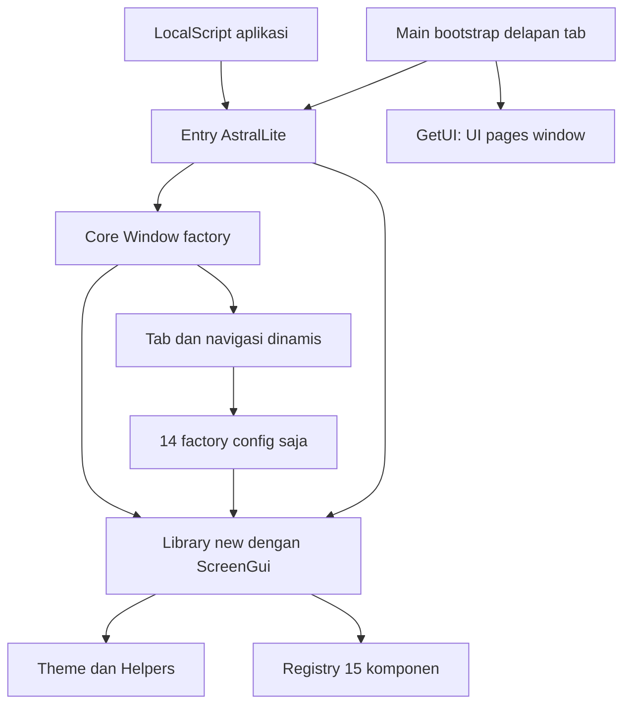

# Arsitektur AstralLite 2.0.0

Versi 2.0.0 **belum dirilis**. Source tetap modular; distribusi satu berkas adalah hasil build dari source yang sama. Inspirasi pola API window/tab dari WindUI tidak menambahkan dependensi, menyalin kode, atau mengganti identitas proyek dengan branding WindUI.

## Lapisan runtime

| Sumber | Tanggung jawab |
| --- | --- |
| `src/shared/UILibrary/init.lua` | Version 2.0.0; ComponentNames sorted/frozen; CreateWindow dot/colon; constructor `.new`; validasi, registry lifecycle, wrapper UI/komponen. |
| `Core/Window.lua` | Factory berparameter library (dependency injection), shell/ScreenGui, window/tab API, navigasi, visibility, input, viewport, ownership. Require modul tidak membuat UI/listener. |
| `Theme.lua` | Salinan default per library dan override parsial terkelompok saat konstruksi. |
| `Helpers.lua` | Number/Callback/Options, Instance/tween, Scope dan lookup internal GetScope, drag mouse/touch. |
| `Components/init.lua` | Registry beku 15 leaf factory; tidak require entry. |
| `Components/*.lua` | Factory `(context, parent, config)` yang mengembalikan API dan `_instance` dengan lifecycle scope. |
| `src/client/Main.client.lua` | Require sumber, CreateWindow, tambah delapan tab judul-saja, publikasikan GetUI dan hook cleanup endpoint. Bukan lagi pemilik implementasi shell. |

Require library tidak memunculkan window/demo. CreateWindow generik membuat GUI/holder dengan **nol tab**; Main-lah yang menambahkan delapan kategori asli dan memilih Home melalui aturan tab pertama. 14 komponen dibuat di tab dengan config saja; Notification dimiliki window/UI dan tetap perlu Show.

## Dua jalur pemasangan

### Sumber melalui Rojo

`default.project.json` **sudah ada**. Path `src/shared/UILibrary` sengaja tidak diganti agar mapping `ReplicatedStorage.UILibrary` kompatibel. `src/client` dipetakan ke `StarterPlayer.StarterPlayerScripts`, menghasilkan LocalScript Main lalu `PlayerScripts.Main` saat Play. Core adalah Folder dengan ModuleScript Window; Components berasal dari init.lua dan memiliki 15 modul anak.

Root `ui.lua` tetap arsip asli, aftman tidak berubah; arsip, dist, dan tests tidak dipetakan. Place `build/AstralLite.rbxlx` dan sourcemap tersedia sebagai generated/ignored. Build final `rojo build default.project.json -o build/AstralLite.rbxlx` dan sourcemap lulus dengan Rojo 7.7.0-rc.1 pada 2026-11-02. Ini bukti build/mapping, bukan eksekusi Studio.

### Distribusi satu ModuleScript

`scripts/build.mjs` membaca hanya library subtree, bukan Main/arsip/tests. Output `dist/AstralLite.lua` mengembalikan tabel library yang sama dan dapat dipasang manual sebagai `ReplicatedStorage.AstralLite`; hierarki modul anak tidak diperlukan. Bootstrap aplikasi ditulis terpisah. Menjalankan bootstrap bundle dan Main sumber bersamaan membuat window tambahan, bukan otomatis berbagi singleton.

## Bundler leksikal dan graph

1. Enumerasi file `.lua` deterministik; tolak symlink, path invalid, node Rojo ambigu, serta `.client.lua`/`.server.lua` di library.
2. Normalisasi BOM dan CRLF/CR menjadi LF. Scanner membedakan token identifier dari komentar, quoted/long strings, field, dan property. Bukan pencarian regex buta untuk mengganti require dan bukan parser/kompiler Luau lengkap.
3. Analisis hanya menerima bentuk `require(script.Child)` atau rantai dot statis `script.Parent.Child` sesuai node Rojo (termasuk init/folder). Alias/dynamic require, referensi script bebas di runtime, identifier bundle reserved, dan string interpolasi ditolak. String/komentar inert tidak diperlakukan sebagai dependency.
4. Resolusi dependency harus menunjuk ModuleScript internal. Missing target/folder, keluar library, cycle (beserta rantai), dan berkas Lua tidak terjangkau dari entry menyebabkan error.
5. DFS dependency terurut menghasilkan urutan topologis; require statis diganti loader internal. Factory lazy memakai cache internal (termasuk hasil false), loading guard, dan pcall; hasil nil/error tidak disimpan sebagai modul sukses.
6. Output source memiliki header hash tiap file dan agregat. Manifest menyimpan `version`, `entry`, `sourceSha256`, `artifactSha256`, `sources[{path,sha256}]`, dan `modules` urutan topologis. Tidak ada timestamp/path mesin untuk determinisme. Hash SHA-256 menjaga integritas, bukan tanda tangan penerbit.
7. Selesaikan graph/render sebelum menulis; staging file sementara, rename atomik per file, manifest dahulu lalu Lua. Pasangan bukan transaksi atomik tunggal; `build:check` mendeteksi pasangan terputus/stale. Error analisis tidak menimpa bundle valid sebelumnya.

Tidak ada loadstring, runtime external require, atau runtime script reference pada bundle. `__require` internal menjalankan closure yang sudah menjadi source, bukan membaca/mengeksekusi string. Larangan source tersebut berlaku pada subtree yang dibundle; Main dan spec boleh memakai script/require platform karena tidak masuk bundle. Gunakan sintaks Luau non-interpolasi dan dependency statis saat menambah modul.

Node 18+ cukup, tanpa paket pihak ketiga. `npm run build` menghasilkan artifact/manifest; `npm run build:check` menghitung ulang dan membandingkan byte tepat tanpa menulis. Versi manifest berasal dari literal entry, **bukan** package.json; entry dan package kini selaras 2.0.0. Build final 2026-11-02 menghasilkan 20 modul dan check byte-exact lulus; kecocokan versi tetap perlu dijaga saat versi berikutnya.

## Transaksi, urutan, dan lifecycle

Constructor window/tab memvalidasi input dan membersihkan hasil parsial jika gagal. Factory komponen memakai staging Frame, memvalidasi Name/Callback/LayoutOrder, memasang ownership dan wrapper **sebelum** root dipublikasikan ke parent, lalu memeriksa apakah parent observer telah menghancurkannya. Registry memakai scope komponen melalui GetScope, bukan hanya menunggu callback Destroying untuk mengetahui explicit destroy. CreateTab juga memeriksa flag window/tab setelah pemilihan tab awal, agar tidak mengembalikan tab yang dihancurkan observer selama seleksi.

Factory tab menyalin config, memakai order sukses maksimum + 1 per tab, dan baru menaikkan penghitung setelah factory sukses. Order eksplisit tinggi menaikkan urutan; negatif tidak menurunkannya; UI tingkat rendah tetap default 1. PageTitle order 0. Map Tabs/Pages adalah referensi hidup; gunakan metode, bukan mutasi manual.

## Kepemilikan

| Pemilik | Yang dibersihkan | Batas |
| --- | --- | --- |
| Window | ScreenGui buatannya, shell, tab, komponen, holder, listener input/kamera | Jangan mengganti dengan UI.Destroy untuk shutdown penuh. |
| Tab | Page/container, tombol navigasi, descendant komponen, entri maps | Hapus tab aktif memilih tab tersisa pertama; tab luar window tidak valid. |
| UI tingkat rendah | Semua komponen terdaftar dan holder, termasuk notifikasi belum Show | Tidak mengambil ownership ScreenGui yang disuplai, parent/panel eksternal, atau Instance dari Helpers langsung. |
| Komponen/Section | Root dan descendants, koneksi/timer/tween terkait; Section juga anak eksternal yang direparent | Tidak mengkloning atau memindahkan registry komponen antar-library. |
| Main hooks | Endpoint GetUI, dua koneksi ke GUI/script; script hook mencoba window.Destroy | Self-Destroying script hanya upaya terbaik pada deferred signals. |

Explicit scope.Destroy menandai state dan mengerjakan cleanup urutan terbalik, lalu secara rekursif memanggil Destroy pada scope descendant yang dikenal registry Helpers yang sama, **secara sinkron sebelum root.Destroy**. Wrapper komponen segera memeriksa flag scope, sehingga descendant terkelola ikut invalid sebelum Destroy pemilik return, tanpa menunggu deferred signal. Error cleanup diperingatkan tanpa menghentikan cleanup lain; ini bukan lookup scope arbitrer dari library/Helpers lain. Destroy idempoten; komponen/tab menolak metode lain setelah mati. Window.IsVisible adalah pengecualian: false setelah destroy. Penghapusan root/GUI dari luar mengikuti jadwal signal Roblox; jangan menjanjikan semua referensi langsung invalid sebelum signal diproses.

Untuk shutdown permanen, **window:Destroy() sebelum menghancurkan script pemilik**. Hide/Minimize/close bukan cleanup; berhentinya script bukan jaminan listener eksternal sudah dilepas. Low-level UI.Destroy menyisakan shell/endpoint dan dapat membuat GetUI masih mengembalikan UI mati; window.Destroy tetap dapat menyelesaikan ownership.

## Main.GetUI

Bootstrap menambahkan Home, Combat, Teleport, Player, Visuals, World, Misc, Settings tanpa demo. OnInvoke dipasang sebelum endpoint diparent ke Main. `GetUI:Invoke()` lokal mengembalikan **UI, pages, window**; dua return pertama kompatibel, bukan salinan. Endpoint tidak ada otomatis pada pemakaian bundle/generic CreateWindow, bukan remote dan bukan API server.

## Layout dan input

- Core.Window mengelola topbar drag, Activated navigasi/control, minimize/restore, RightShift, bounds inset-aware, kamera aktif, dan UIScale. Topbar belum di-clamp; logo dikonversi scale+offset ke piksel sebelum clamp, termasuk layar sangat kecil.
- BindDrag memakai listener global hanya selama gesture, melacak touch pemula; release/focus lost/destroy menghentikan gesture. Tidak ada global input manager bersama: capture key independen dan RightShift membuka semua window.
- Setiap window menukar listener ViewportSize saat CurrentCamera berubah; bounds.AbsoluteSize juga memperbarui layout. Skala tanpa floor 0,55 menjaga ukuran tetapi dapat membuat teks kecil.
- Section mengalibrasi ancestor UIScale dari `header.AbsoluteSize.Y / 32`, mengonversi AbsoluteContentSize piksel menjadi tinggi logis + padding. Menghindari feedback AutomaticSize. Spec 0,5/1/2 tersedia; ini penjelasan implementasi, **bukan hasil uji Studio**.
- Tema hanya konstruksi; window memakai override masing-masing. Tidak ada live update, persistence, gameplay, remote, atau gamepad/aksesibilitas yang telah diverifikasi.

Validasi sumber/tooling/dokumentasi selesai 2026-11-02: 24/24 tes Node tanpa fail/skip, bundle 20 modul v2.0.0 beserta byte-exact check, build/sourcemap Rojo, validator 15 factory dan kompilasi 24 Lua, serta diagnostik editor bersih. Hasil terperinci di [AUDIT.md](AUDIT.md), prosedur publikasi di [RELEASING.md](RELEASING.md). Studio source/bundle specs, input/render/perangkat/memori belum dijalankan; runtime Studio tidak tersedia. Build/compiler/Node tidak menggantikan bukti runtime tersebut. Release/tag belum dipublikasikan.
